<div align="center">



<a href="https://github.com/USERNAME">
  
</a>

</div>

<br/>

## `> whoami`

```text
┌──────────────────────────────────────────────────────────────┐
│  NAME       Abhishek Maurya                                  │
│  BASE       Mumbai, India                                    │
│  ROLE       Founder @ AIVAARA  ·  aivaara.in                 │
│  EDU        B.Tech CSE (AI & ML) · Class of 2029 · Year 2    │
│  FOCUS      Low-level systems × AI × Orbital mechanics       │
│             × Fast backend architectures                     │
├──────────────────────────────────────────────────────────────┤
│  STATUS     ● ONLINE                                         │
│  ACTIVE     Building AIVAARA                                 │
│  PRIMARY    Python  ·  C++                                   │
│  LEARNING   Rust → Go → Java                                 │
│  PRACTICE   DSA / LeetCode · VAPT labs · Systems internals   │
└──────────────────────────────────────────────────────────────┘
```

## `> stack`

<p align="center">
  
</p>

<p align="center">
  <sub><code>NEXT //</code></sub>&nbsp;
  
</p>

| Layer | Stack |
| :-- | :-- |
| **Languages** | C++ · Python *(primary)* · Rust, Go, Java *(next)* |
| **Backend & Core CS** | FastAPI · Linux · DSA (LeetCode) · Operating Systems · DBMS · Computer Networking |
| **Cybersecurity** | Gray-box VAPT · Nmap · SQLi · XSS · SSRF · IDOR · Network Traffic Analysis · Log Analysis |

## `> telemetry`

<div align="center">
  
  
</div>

## `> trajectory`

<div align="center">
  <picture>
    <source media="(prefers-color-scheme: dark)" srcset="https://raw.githubusercontent.com/USERNAME/USERNAME/output/github-snake-dark.svg" />
    
  </picture>
</div>

<br/>

<div align="center">
  <a href="https://aivaara.in"><code>[ aivaara.in ]</code></a>
  <br/><br/>
  <sub><code>// bridging bare metal and orbit</code></sub>
</div>
